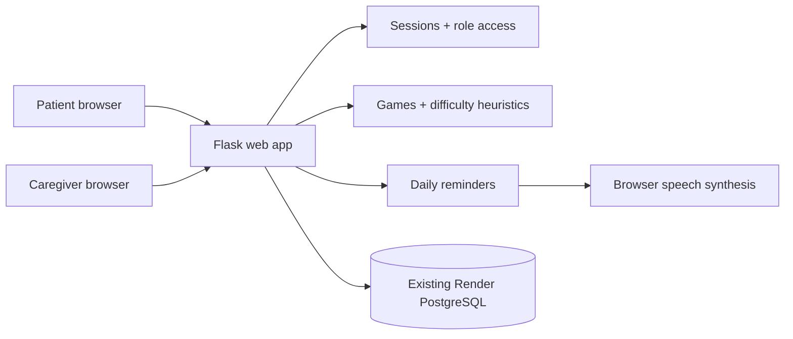

# MindCare AI

**MindCare AI: An Intelligent Cognitive Gaming and Memory Assistance Platform for Elderly Dementia Patients** — a college mini-project prototype designed with the North Eastern Region (NER) of India in mind.

> **Non-medical educational prototype.** The games provide cognitive engagement, not proven treatment. Performance scores, game trends, and heuristic labels cannot diagnose dementia, assess disease progression, or replace a clinician. Reminder acknowledgements are self-reported, not proof of medicine intake.

## Included features

- Responsive, large-tap-target patient interface and caregiver dashboard.
- Patient and caregiver registration and password hashing.
- Caregiver consent: patient shares a short code; caregiver **requests** access; patient **approves or revokes**. Unapproved caregivers cannot read patient data.
- Six games: card matching, word recall, number sequence, picture recognition, picture puzzle (drag/tap-to-swap), and family photo recognition.
- Per-game adaptive difficulty: two consecutive strong sessions (score at least 85%, at most three mistakes) at the *same* level increase difficulty by one step; two sessions at or below 45% decrease it by one step. Difficulty changes after the game, not during it. All six games increase in complexity with level, independently. This is transparent rule-based adaptation, not a trained AI model.
- Daily reminders for medicine, meals, appointments, activities and family events with **always-on-by-default** browser text-to-speech across patient pages while a visible browser tab remains open. Voice preference chooses gentle feminine-named voices when installed (such as Jenny, Aria or Samantha), at a relaxed pace. First tap/keypress may be required by browser autoplay policy; exact voice cannot be guaranteed across devices.
- Secure caregiver upload and viewing of family photos; stored in PostgreSQL, not ephemeral Render disk. **No automated face recognition** is performed.
- Daily score chart, activity summary and transparent, non-clinical heuristic flag based on rolling recent games.
- PostgreSQL persistence (or SQLite for local development), role authorization, CSRF protection, login sessions, secure headers, upload validation, and environment-based secrets.

## Architecture



### Database tables

`user`, `care_link`, `game_result`, `reminder`, `reminder_check`, `family_member`, `video_call`, `video_signal`. SQLAlchemy creates only missing tables at application startup. **Existing database tables are not deliberately dropped or overwritten.** Use migrations for future schema changes.

## Run locally

Requires Python 3.12+, `pip`, and terminal access.

```bash
python -m venv .venv
source .venv/bin/activate # on Windows: .venv\Scripts\activate
pip install -r requirements.txt
export SECRET_KEY="$(python -c 'import secrets; print(secrets.token_urlsafe(48))')"
python app.py
```

Open `http://localhost:5000`. Without `DATABASE_URL`, local SQLite is used automatically.

To use your existing Render Postgres, set `DATABASE_URL` in your local environment or Render Environment pane. **Never hardcode it in Python, Git, README, `.env.example`, screenshots, or logs.** If using an external connection from your computer, configure `sslmode=require` according to Render's instructions. Production deployments should prefer Render's **internal** connection URL when hosted in the same workspace and region.

## Deploy using the existing database on Render — free web service

1. **Create a repository** under the intended GitHub account, e.g. `shivamani0426/mindcare-ai`, and push the project folder's files to its `main` branch. The repository can be private if Render is connected and has permission.
2. On Render, choose the workspace holding the **existing** `miniproject` Postgres database in **Ohio**. **Do not create a second database.**
3. Use **New > Web Service** linked to the repository, with region `Ohio`, plan `Free`, runtime `Python`, build `pip install -r requirements.txt`, start `gunicorn --bind 0.0.0.0:$PORT --workers 1 --threads 4 --timeout 90 app:app`. Alternatively use the included `render.yaml` Blueprint, but its first plan must be reviewed and approved; fill `DATABASE_URL` privately.
4. Set Environment variables: `DATABASE_URL` = the **internal** URL from Render Postgres > Connect > Internal (or the external URL with SSL/TLS), `SECRET_KEY` = a new random value, `SECURE_COOKIES=1`. Don't put these in Git.
5. Deploy. Monitor until the deployment reports **Live** and open `/health`: the response must show `{"status":"ok","database":"connected"}`.
6. Create a patient account, copy its invite code, create a caregiver account, request access, switch to the patient account, approve access, then test games and reminders.

This free web service may sleep when idle. Render's free Postgres instance is time-limited: verify expiration and export important data before expiry. Family photos count against database storage. For a real health service, professional privacy, security, clinical, data retention, consent, accessibility, and regulatory review are required.

## Tests

```bash
pip install pytest
pytest -q
```

Tests cover registration, CSRF, consent/access revocation, reminders, saving game results, bidirectional adaptive difficulty, and authenticated video-call signaling. GitHub Actions runs these tests on pushes to `main`. Real browser accessibility/device testing is still required.

## How the non-clinical heuristics work

- New game = **Gentle** difficulty.
- Two consecutive scores of 85% or higher with at most three mistakes on the same level promote that game by one level.
- Two consecutive scores of 60% or below, or scores of 72% or below combined with at least four mistakes, reduce that game by one level. A single very difficult round (25% or below, at least three mistakes) also reduces the level from Growing/Challenge.
- Changes take effect in the next round; levels never jump more than one step and each game adapts independently.
- At least 10 games are required before comparing the latest 5 with the previous 5.
- Scores down 8–18 points are shown as **Needs attention**; drops of 18+ as **Check in**. These are gameplay-only labels and can reflect normal variation, fatigue, help from others, internet issues or difficulty changes. Do not interpret as medical deterioration.

## Known limits and deployment checklist

- Spoken reminders require **an open browser tab** and user permission/interaction. There is no SMS, push notification, mobile background alarm, or reliable medication-adherence detection.
- No automatic photographic face identification; users identify people from caregiver-labelled images.
- No machine-learning model is trained; “AI” refers to transparent rule-based adaptation. Future work could validate a personalised ML approach with consent and a clinical partner.
- No identity verification, email verification, password reset, audit trail, import/export or hardened rate limiting. **Do not populate with real patient medical information until these and other safeguards have been assessed.**
- No healthcare compliance certification is claimed.
- Intended first as a supervised college demonstration, not unattended clinical deployment.

## Repository structure

```text
mindcare-ai/
├── app.py              # models, auth, consent, API, views
├── templates/          # page layouts for patients and caregivers
├── static/             # responsive CSS, games, voice reminders, garden art
├── tests/              # pytest integration tests
├── requirements.txt
├── render.yaml         # free web service; no new database
├── Procfile
├── .env.example        # placeholders only
├── .gitignore
└── README.md
```

**License:** MIT for this original mini-project implementation. Third-party dependencies retain their own licenses.

## Gentle voice and adaptive games (November 2026 update)

- The patient voice guide is automatically enabled on every page; click **🔊 Gentle voice is on** in the header to repeat its welcome. No extra activation toggle is required. It offers spoken game instructions and due reminders, with no external TTS API. Speech remains on the user's device. Some browsers require the first user tap to allow speech, and voice choices depend on installed browser/OS voices. It does **not** talk or send notifications after the website/tab is closed.
- Each game starts at Gentle (level 1). After two consecutive high-scoring plays at that same level, the *next* play is Growing (level 2), then Challenge (level 3). Two low-scoring plays reduce difficulty without penalizing the patient. The response time is recorded for caregiver activity summaries but is not used to rush someone into a harder task.
- Game differences: memory card pairs (3/5/8), word count (3/5/7), number length (4/6/8), picture rounds and answer options (3/5/6), puzzle tiles (2×2/3×3/4×4), and family name and relationship questions (family photos supplied by caregivers).
- No database schema migrations required for this update; existing results and accounts are retained.


## One-tap caregiver video calls (November 2026 update)

1. Create a patient and caregiver account and connect them using the existing patient-issued code and explicit patient approval.
2. From either dashboard, tap **📹 Video call** beside the approved caregiver or patient. No phone number, paid video SDK, or account with a third-party video provider is needed.
3. The recipient must be **logged in with MindCare open**. The site checks every four seconds and shows **Answer video call** / **Not now**. The caller's invite expires after three minutes if nobody answers.
4. The camera and microphone require explicit browser permission over HTTPS. Once the recipient accepts, WebRTC transfers audio and video directly between devices where possible. Both people can mute audio, disable video, or end the call.
5. Call signaling uses two new PostgreSQL tables (`video_call`, `video_signal`). No media is stored or recorded by MindCare. Signaling data is deleted when calls end and stale call records are cleaned up opportunistically. Approved caregiver access is checked on every signaling request; revoking approval stops further authorized signaling and ends the call.

### Connectivity and privacy limitations

- WebRTC uses a public STUN server for connection discovery. Some mobile carriers, firewalls and symmetric-NAT networks **cannot connect reliably without a TURN relay**. To use a trusted TURN service, set `TURN_URL`, `TURN_USERNAME`, and `TURN_PASSWORD` in **Render private environment settings**, never source code. Long-lived TURN credentials become accessible to signed-in call participants and should be scoped and rotated by the relay provider. No TURN service or billable resources are provisioned here.
- Calls are not automatically answered: receiving caregivers must consent. Browser permission prompts may require more than one click on the first call; the patient's single tap initiates the call.
- No remote push notifications, SMS, recordings, emergency calling, or background-call delivery. The caregiver should keep the website open to receive the on-screen alert. MindCare itself does not record calls, but it cannot prevent participants from using their own screen recording software.
- Transport uses encrypted WebRTC channels, but this student project is **not** a healthcare-grade or certified communications system and should not be used for emergency services or confidential clinical discussions without additional security and compliance review.
- The existing calm spoken guide pauses during a call so it does not interrupt the conversation.
