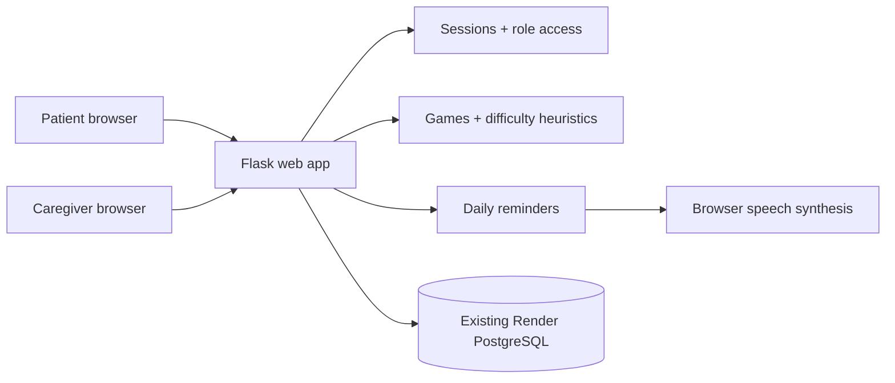

# MindCare AI

**MindCare AI: An Intelligent Cognitive Gaming and Memory Assistance Platform for Elderly Dementia Patients** — a college mini-project prototype designed with the North Eastern Region (NER) of India in mind.

> **Non-medical educational prototype.** The games provide cognitive engagement, not proven treatment. Performance scores, game trends, and heuristic labels cannot diagnose dementia, assess disease progression, or replace a clinician. Reminder acknowledgements are self-reported, not proof of medicine intake.

## Included features

- Responsive, large-tap-target patient interface and caregiver dashboard.
- Patient and caregiver registration and password hashing.
- Caregiver consent: patient shares a short code; caregiver **requests** access; patient **approves or revokes**. Unapproved caregivers cannot read patient data.
- Six games: card matching, word recall, number sequence, picture recognition, picture puzzle (drag/tap-to-swap), and family photo recognition.
- Per-game adaptive difficulty: two consecutive strong sessions (score at least 85%, at most three mistakes) at the *same* level increase difficulty by one step; two sessions at or below 45% decrease it by one step. Difficulty changes after the game, not during it. All six games increase in complexity with level, independently. This is transparent rule-based adaptation, not a trained AI model.
- Daily reminders for medicine, meals, appointments, activities and family events with **always-on-by-default** browser text-to-speech across patient pages while a visible browser tab remains open. Voice preference chooses gentle feminine-named voices when installed (such as Jenny, Aria or Samantha), at a relaxed pace. First tap/keypress may be required by browser autoplay policy; exact voice cannot be guaranteed across devices.
- Secure caregiver upload and viewing of family photos; stored in PostgreSQL, not ephemeral Render disk. **No automated face recognition** is performed.
- Daily score chart, activity summary and transparent, non-clinical heuristic flag based on rolling recent games.
- PostgreSQL persistence (or SQLite for local development), role authorization, CSRF protection, login sessions, secure headers, upload validation, and environment-based secrets.

## Architecture



### Database tables

`user`, `care_link`, `game_result`, `reminder`, `reminder_check`, `family_member`, `video_call`, `video_signal`. SQLAlchemy creates only missing tables at application startup. **Existing database tables are not deliberately dropped or overwritten.** Use migrations for future schema changes.

## Run locally

Requires Python 3.12+, `pip`, and terminal access.

```bash
python -m venv .venv
source .venv/bin/activate # on Windows: .venv\Scripts\activate
pip install -r requirements.txt
export SECRET_KEY="$(python -c 'import secrets; print(secrets.token_urlsafe(48))')"
python app.py
```

Open `http://localhost:5000`. Without `DATABASE_URL`, local SQLite is used automatically.

To use your existing Render Postgres, set `DATABASE_URL` in your local environment or Render Environment pane. **Never hardcode it in Python, Git, README, `.env.example`, screenshots, or logs.** If using an external connection from your computer, configure `sslmode=require` according to Render's instructions. Production deployments should prefer Render's **internal** connection URL when hosted in the same workspace and region.

## Deploy using the existing database on Render — free web service

1. **Create a repository** under the intended GitHub account, e.g. `shivamani0426/mindcare-ai`, and push the project folder's files to its `main` branch. The repository can be private if Render is connected and has permission.
2. On Render, choose the workspace holding the **existing** `miniproject` Postgres database in **Ohio**. **Do not create a second database.**
3. Use **New > Web Service** linked to the repository, with region `Ohio`, plan `Free`, runtime `Python`, build `pip install -r requirements.txt`, start `gunicorn --bind 0.0.0.0:$PORT --workers 1 --threads 4 --timeout 90 app:app`. Alternatively use the included `render.yaml` Blueprint, but its first plan must be reviewed and approved; fill `DATABASE_URL` privately.
4. Set Environment variables: `DATABASE_URL` = the **internal** URL from Render Postgres > Connect > Internal (or the external URL with SSL/TLS), `SECRET_KEY` = a new random value, `SECURE_COOKIES=1`. Don't put these in Git.
5. Deploy. Monitor until the deployment reports **Live** and open `/health`: the response must show `{"status":"ok","database":"connected"}`.
6. Create a patient account, copy its invite code, create a caregiver account, request access, switch to the patient account, approve access, then test games and reminders.

This free web service may sleep when idle. Render's free Postgres instance is time-limited: verify expiration and export important data before expiry. Family photos count against database storage. For a real health service, professional privacy, security, clinical, data retention, consent, accessibility, and regulatory review are required.

## Tests

```bash
pip install pytest
pytest -q
```

Tests cover registration, CSRF, consent/access revocation, reminders, saving game results, bidirectional adaptive difficulty, and authenticated video-call signaling. GitHub Actions runs these tests on pushes to `main`. Real browser accessibility/device testing is still required.

## How the non-clinical heuristics work

- New game = **Gentle** difficulty.
- Two consecutive scores of 85% or higher with at most three mistakes on the same level promote that game by one level.
- Two consecutive scores of 60% or below, or scores of 72% or below combined with at least four mistakes, reduce that game by one level. A single very difficult round (25% or below, at least three mistakes) also reduces the level from Growing/Challenge.
- Changes take effect in the next round; levels never jump more than one step and each game adapts independently.
- At least 10 games are required before comparing the latest 5 with the previous 5.
- Scores down 8–18 points are shown as **Needs attention**; drops of 18+ as **Check in**. These are gameplay-only labels and can reflect normal variation, fatigue, help from others, internet issues or difficulty changes. Do not interpret as medical deterioration.

## Known limits and deployment checklist

- Spoken reminders require **an open browser tab** and user permission/interaction. There is no SMS, push notification, mobile background alarm, or reliable medication-adherence detection.
- No automatic photographic face identification; users identify people from caregiver-labelled images.
- No machine-learning model is trained; “AI” refers to transparent rule-based adaptation. Future work could validate a personalised ML approach with consent and a clinical partner.
- No identity verification, email verification, password reset, audit trail, import/export or hardened rate limiting. **Do not populate with real patient medical information until these and other safeguards have been assessed.**
- No healthcare compliance certification is claimed.
- Intended first as a supervised college demonstration, not unattended clinical deployment.

## Repository structure

```text
mindcare-ai/
├── app.py              # models, auth, consent, API, views
├── templates/          # page layouts for patients and caregivers
├── static/             # responsive CSS, games, voice reminders, garden art
├── tests/              # pytest integration tests
├── requirements.txt
├── render.yaml         # free web service; no new database
├── Procfile
├── .env.example        # placeholders only
├── .gitignore
└── README.md
```

**License:** MIT for this original mini-project implementation. Third-party dependencies retain their own licenses.

## Gentle voice and adaptive games (November 2026 update)

- The patient voice guide is automatically enabled on every page; click **🔊 Gentle voice is on** in the header to repeat its welcome. No extra activation toggle is required. It offers spoken game instructions and due reminders, with no external TTS API. Speech remains on the user's device. Some browsers require the first user tap to allow speech, and voice choices depend on installed browser/OS voices. It does **not** talk or send notifications after the website/tab is closed.
- Each game starts at Gentle (level 1). After two consecutive high-scoring plays at that same level, the *next* play is Growing (level 2), then Challenge (level 3). Two low-scoring plays reduce difficulty without penalizing the patient. The response time is recorded for caregiver activity summaries but is not used to rush someone into a harder task.
- Game differences: memory card pairs (3/5/8), word count (3/5/7), number length (4/6/8), picture rounds and answer options (3/5/6), puzzle tiles (2×2/3×3/4×4), and family name and relationship questions (family photos supplied by caregivers).
- No database schema migrations required for this update; existing results and accounts are retained.


## One-tap caregiver video calls (November 2026 update)

1. Create a patient and caregiver account and connect them using the existing patient-issued code and explicit patient approval.
2. From either dashboard, tap **📹 Video call** beside the approved caregiver or patient. No phone number, paid video SDK, or account with a third-party video provider is needed.
3. The recipient must be **logged in with MindCare open**. The site checks every four seconds and shows **Answer video call** / **Not now**. The caller's invite expires after three minutes if nobody answers.
4. The camera and microphone require explicit browser permission over HTTPS. Once the recipient accepts, WebRTC transfers audio and video directly between devices where possible. Both people can mute audio, disable video, or end the call.
5. Call signaling uses two new PostgreSQL tables (`video_call`, `video_signal`). No media is stored or recorded by MindCare. Signaling data is deleted when calls end and stale call records are cleaned up opportunistically. Approved caregiver access is checked on every signaling request; revoking approval stops further authorized signaling and ends the call.

### Connectivity and privacy limitations

- WebRTC uses a public STUN server for connection discovery. Some mobile carriers, firewalls and symmetric-NAT networks **cannot connect reliably without a TURN relay**. To use a trusted TURN service, set `TURN_URL`, `TURN_USERNAME`, and `TURN_PASSWORD` in **Render private environment settings**, never source code. Long-lived TURN credentials become accessible to signed-in call participants and should be scoped and rotated by the relay provider. No TURN service or billable resources are provisioned here.
- Calls are not automatically answered: receiving caregivers must consent. Browser permission prompts may require more than one click on the first call; the patient's single tap initiates the call.
- No remote push notifications, SMS, recordings, emergency calling, or background-call delivery. The caregiver should keep the website open to receive the on-screen alert. MindCare itself does not record calls, but it cannot prevent participants from using their own screen recording software.
- Transport uses encrypted WebRTC channels, but this student project is **not** a healthcare-grade or certified communications system and should not be used for emergency services or confidential clinical discussions without additional security and compliance review.
- The existing calm spoken guide pauses during a call so it does not interrupt the conversation.

## Full-screen family photo viewer

Tap a family photo (or its **View photo** control in the directory) to open the private, full-viewport viewer. Caregivers and patients can close it with the large Close control or Escape, move through photos with arrows or a touch swipe, and optionally enter device full-screen mode on supported browsers. The viewer preserves photo aspect ratio using `object-fit: contain` and requests the already-authorized same-origin image URL; no new public image endpoints or database changes are required.


## Patient dashboard expansion (November 2026)

Patient-only features: an orientation card with today's date/time in India, the patient's name, next scheduled reminder and familiar family faces; a private daily wellbeing check-in (one record per patient per India calendar day, editable on the same day); an accessible Help & contacts page with up to five patient-controlled phone shortcuts and approved-caregiver video calls; and account-persistent language, large-text, contrast and reduced-motion preferences. English, Hindi and Kannada labels cover the *new panels and common patient navigation*; older games and spoken instructions remain primarily in English.

A wellbeing 'Need support' selection is **not an emergency alert** and does **not automatically send SMS/push/email to caregivers**. The Help button shows `tel:` dialer shortcuts, the India 112 emergency number and existing caregiver video-call options. Calling requires a compatible device/service and user action; the app cannot silently make emergency calls or share location. For genuine emergencies follow local emergency procedures.

New PostgreSQL tables: `wellbeing_check`, `emergency_contact`, `patient_preference`. Startup `db.create_all()` adds missing tables without modifying existing family photos, accounts, games, reminders, or care links.

Notifications while the website is closed **remain a separate future feature**, requiring a push subscription/service worker/notification worker plus explicit opt-in; browser voice reminders still require an open tab. The caregiver dashboard has not been modified in this phase.


## Patient Dashboard 2.1 — Accessibility completion

**Simple View:** Patients can use the dashboard shortcut or Settings to opt into a low-distraction home screen (four large actions: next reminder, play, contact family on WhatsApp, family photos). The preference is persisted in the new \`patient_view_mode\` table, so production databases do not require an ALTER TABLE migration. "Show full dashboard" is always visible. Important unfinished reminders are retained on the next-step tile.

**Need support:** The wellbeing check-in is still a self-report, **not an automatically sent alert**. When "Need support" is selected and saved, the dashboard shows explicit Help & contacts / trusted-person WhatsApp actions. A WhatsApp link only opens the person's chat. The patient must tap WhatsApp's call icon. India emergency 112 continues to use the phone dialer.

**Edit instead of delete:** Contact cards and reminder cards have native, keyboard-accessible Edit disclosures. POST handlers validate CSRF, patient ownership, phone numbers, reminder date/time and length; rescheduling resets only today's previously checked tick.

**Optional browser alerts:** The reminder page has an Enable browser alerts button. Notifications ask permission only after a click, apply to that browser/device, can be turned off, show due reminders (with a 15-minute grace period) and deduplicate on the device. They require MindCare to remain open: **not Web Push**, not a system alarm and not guaranteed after the browser closes. The existing spoken reminders likewise need the browser open and audio permission. Hindi/Kannada voices are used when installed; otherwise speech falls back to English rather than reading non-English text incorrectly.

**Translations:** Expanded Hindi/Kannada UI for patient dashboard, reminders, help, family and game instructions, with dynamic in-game labels and native-voice capability detection. User-provided contact names, family names and reminder text are never translated automatically; fallback to English is used for unsupported text.

**QA:** CI checks Python syntax, Flask API tests, app JS and patient-specific scripts. End-to-end browser, screen reader, real device and caregiver acceptance testing remain essential before using the app for independent daily care.


## Caregiver Dashboard 2.0

Caregivers see only patient accounts **that explicitly approved their connection**. The dashboard now provides:

- A daily care-circle summary with approved patient count, today's voluntary wellbeing check-ins, unreviewed support check-ins from the last seven days, and past-due reminders that the patient has not marked complete.
- A searchable, filterable patient directory with easy access to activity details, reminders, family photos and the existing consent-based video call.
- A private **Support check-ins** review queue. The patient can choose *Need support* and optionally write a note. The caregiver sees it when they open or refresh MindCare, not as a real-time alert. A **Mark reviewed** action records only that this caregiver saw the entry. It does not notify or contact the patient. When a patient changes a need-support note, any previous review acknowledgement is cleared so the request appears again.
- A patient-specific wellbeing timeline of up to 14 daily check-ins, self-reported reminder acknowledgements and game engagement stats. Game scores are **not** medical assessments.
- Pending connection requests remain separated from approved patient data. Revoking approval immediately prevents the caregiver from viewing records or acknowledging support.

**Privacy/safety:** Review records are tied to the currently approved caregiver account. This workflow is not intended as urgent response, emergency dispatch, automatic push notification, medical diagnosis, or verification that medicine was taken. Keep the application's separate 112 emergency action and the patient's existing WhatsApp call handoff unchanged. No external service is contacted when a caregiver clicks *Mark reviewed*.

### Tests
The project runs Python permission/unit tests and two disposable Chromium journeys through GitHub Actions: \`tests/browser_smoke.py\` for patients and \`tests/browser_caregiver_smoke.py\` for caregivers. Both use isolated local databases and do not alter production accounts.


## Secure sign-in: Google, email and mobile OTP

MindCare's refreshed sign-in and registration pages retain working email/password login. Google and Firebase phone login activate only when administrator credentials exist. A disabled provider never claims an SMS was sent or an external identity verified.

### Enable Google OAuth

1. In the [Google Cloud Console](https://console.cloud.google.com/apis/credentials), configure Google Auth Platform, OAuth consent screen and create a Web application OAuth client.
2. Add the exact authorized redirect URI: https://mindcare-ai-ner.onrender.com/auth/google/callback
3. Set the following Render service environment variables. Keep secret values private:
   - GOOGLE_CLIENT_ID (OAuth client identifier)
   - GOOGLE_CLIENT_SECRET (private OAuth secret)
   - GOOGLE_REDIRECT_URI = https://mindcare-ai-ner.onrender.com/auth/google/callback
4. Redeploy the service. The **Continue with Google** button will become enabled. MindCare never sees a user's Google password.
5. New users select Patient or Caregiver only after Google verifies them. Existing email/password users should sign in first, click their name, and choose **Account security > Connect Google**. To protect existing records, the Google verified email must match the original account's email. Never automatically link solely by email.

### Enable phone OTP with Firebase

Firebase phone sign-in needs an active Firebase Auth project and can incur charges for real SMS delivery. [Official setup documentation](https://firebase.google.com/docs/auth/web/phone-auth).

1. Create a Firebase project and Web app; enable Authentication > Sign-in method > Phone.
2. Add mindcare-ai-ner.onrender.com to authorized authentication domains. Set an SMS region policy allowing intended countries such as India. Configure billing, budget alerts, fraud controls and quota limits as Firebase requires.
3. Configure these variables privately in the Render service:
   - FIREBASE_API_KEY (public web configuration)
   - FIREBASE_AUTH_DOMAIN (your-project.firebaseapp.com)
   - FIREBASE_PROJECT_ID (Google/Firebase project ID)
   - FIREBASE_APP_ID (Firebase web application ID)
   - FIREBASE_SERVICE_ACCOUNT_JSON (private full JSON credential, NEVER expose in GitHub or HTML)
4. Redeploy. Users can tap Phone OTP, complete Firebase reCAPTCHA, enter their E.164 number (for example +919876543210) and confirm the SMS. Firebase Admin validates the ID token's signature, project, phone provider and revocation before Flask starts a session.
5. Verified new users choose Patient or Caregiver. A previously registered user can connect a verified phone from **Account security** without recreating their patient records. For cost-free QA, Firebase supports fictional test numbers that never send real SMS.

**Security and operational cautions:** Firebase charges for eligible real SMS; a phone number may be reassigned or SIM-swapped, making phone-only sign-in weaker than password+MFA. Configure spend controls, throttling, account recovery, log audit and professional security/privacy review before real clinical use. No password-reset email or automatic SMS alert is implemented. The existing WhatsApp trusted-contact feature, patient/caregiver roles, consent checks and emergency 112 dialer are unchanged. Account linking is deliberate and never based on phone/email similarity alone.


## Milo 1.0 — roaming companion

Milo is an optional, cute green plant companion rendered with CSS and controlled by JavaScript on **signed-in patient pages only**. No paid AI, behavioural tracking, external services, patient interaction logging or emergency alerts are involved.

- When browser motion is allowed, Milo walks autonomously between clear places near the edges/bottom of the screen, rests, blinks and waves on hover. It avoids intentionally stopping on interactive controls.
- Tapping Milo stops walking and opens a help panel with page-specific instructions, optional user-triggered voice playback, and links to Games, Reminders, Family and Help & contacts. It does not play games for the patient or make medical claims.
- The Milo button in the navigation bar allows patients to Hide and Show the character. The panel has a Pause/Resume control. Both settings persist on that device in local browser storage.
- Respects the system reduced-motion preference and patient-specific reduced motion. Milo stays stationary on game-play pages, during interaction with the help panel and while entering information.
- Help labels and explanations are localized into English, Hindi and Kannada. Spoken help availability depends on the user's browser.
- If safe roaming positions are unavailable, Milo prefers remaining still rather than deliberately standing over a form control.

Existing WhatsApp, 112, consent, authentication, database, games, reminders and caregiver workflows are unaffected. Browser QA covers ordinary and reduced motion, access isolation, help, hide/pause persistence, and responsive layouts.


## Dark illustrated MindCare World landing page

The **public homepage only** uses an original arcade-inspired art direction: near-black scanline background, oversized monochrome display headings, warm purple/blue/green illustrated MindCare landscape, white pill CTAs and lime active control states. It includes a full-viewport hero, sticky section navigation, two-line manifesto, original immersive artwork, three accessible capability tabs, two interactive simulated (not real patient data) patient/caregiver interface previews, six original feature gallery cards in horizontally scrollable two offset rows, entry CTAs, and a matching oversized brand footer.

Design reference inspired the layout and rhythm, but all artwork, names, copy, gallery scenes and interface mockups are original MindCare assets. No reference trademarks, logos, images, fonts or UI code are reused. Files are templates/home.html, static/mindcare-world.svg, static/landing-world.css and static/landing-world.js. The homepage relies on zero external CDNs, fonts, browser permissions or account data.

Links to Login and Create Account use their **existing working Flask routes**. Auth pages, patient/caregiver dashboards, memory games, reminder scheduling, family photos, approved care connections, WhatsApp handoff, Milo, and emergency 112 keep their independent accessible layouts and backend behaviour. This separation matters for low-vision or cognitively vulnerable patients.

All feature gallery cards represent existing platform concepts; the gallery is **not** a real community or user-posted collection. Simulated dashboard previews are clearly labeled as fictional; there is no customer-data exposure. The footer privacy/usage notes are short prototype notices, not a replacement for a full privacy policy, regulatory analysis, or Terms of Service.

Keyboard navigation works for capability tabs (left/right/home/end), both preview dots, all section anchors, and the horizontally scrollable gallery. Animation respects reduced-motion settings. The Python and Playwright suites check functionality and responsiveness down to 320px.
